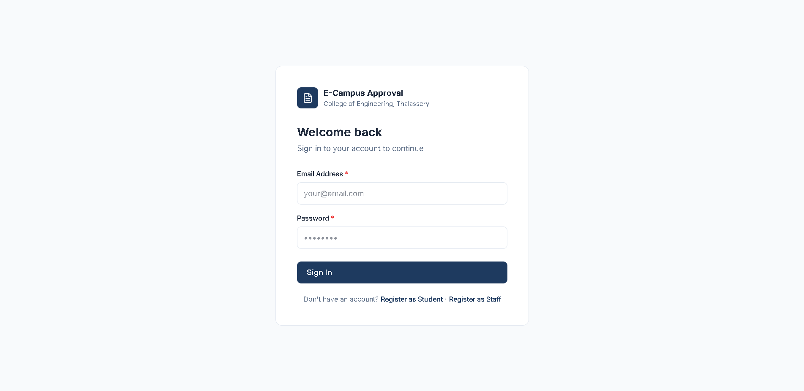
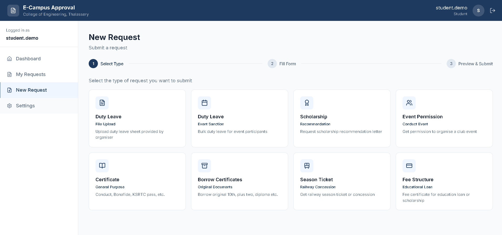
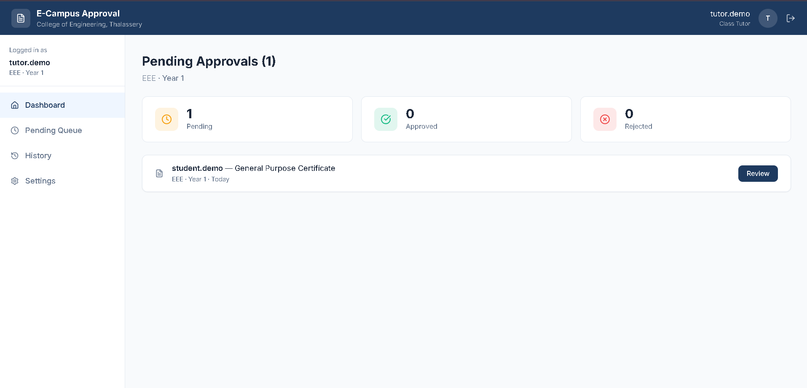

# Campus E-Approval System

A full-stack web app that replaces paper-based campus permission letters with a digital approval workflow. Students submit requests online, authorities approve them step by step, and the system issues a **PDF permission letter with a QR code** that anyone can verify.

**Live demo:** https://e-campus-approval.vercel.app/login

> The backend runs on a free tier, so the first login can take 30-60 seconds while the server wakes up. Please wait for it to respond.

## The problem

In our college, request letters moved on paper. Students waited a long time for tutors, HODs and principals to sign, with no way to track progress. This project automates the whole flow, from submission to a verifiable signed document.

## Try it

Demo accounts (test data only):

| Role | Email | Password |
|---|---|---|
| Student | student.demo@ecampus.test | Demo@1234 |
| Tutor | tutor.demo@ecampus.test | Demo@1234 |
| HOD | hod.demo@ecampus.test | Demo@1234 |
| Principal | principal.demo@ecampus.test | Demo@1234 |


Suggested flow:
1. Log in as the **Student** and submit a request.
2. Log in as the **Tutor**, then **HOD**, then **Principal**, and approve it.
3. As the student, open the generated PDF and scan its QR code to verify it.


## Screenshots

**Login**



**Student: choose a request type (8 types, 3-step flow)**



**Tutor: pending approvals dashboard**



## Key features

- **Six roles:** Student, Tutor, Faculty Coordinator, HOD, Principal and Office Staff, each with their own dashboard and permissions.
- **Dynamic approval chains:** the route depends on the request type (e.g. Tutor → HOD → Principal, or Faculty Coordinator → Principal). Rejections require a comment.
- **Eight request types:** duty leave, scholarship recommendation, event permission, certificates, railway concession, educational loan fee structure and more.
- **Real-time updates:** Socket.io notifies users when a request is assigned or its status changes.
- **PDF permission letters:** generated after final approval, with authority signatures, and stored on Cloudinary.
- **QR verification:** each letter has a QR code linking to a public page that checks an HMAC-SHA256 token and shows the approval chain.
- **Office processing:** for certificate-type requests, staff record processing, handover and returns.
- **Security:** JWT authentication, bcrypt password hashing and role-based authorization middleware.

## Tech stack

| Layer | Technologies |
|---|---|
| Frontend | React 19, Vite, React Router, Tailwind CSS, Axios, Socket.io Client |
| Backend | Node.js, Express 5, Socket.io |
| Database | MongoDB with Mongoose |
| Auth | JWT, bcrypt |
| Files and documents | Cloudinary, Multer, Puppeteer Core (PDF), qrcode |
| Deployment | Vercel (frontend), Render (backend) |

## Run locally

Requires Node.js, MongoDB (local or Atlas) and a Cloudinary account.

```bash
git clone https://github.com/muhdzwafee128/e-campus-approval.git
cd e-campus-approval
```

**Backend**

```bash
cd server
npm install
```

Create `server/.env`:

```env
PORT=5000
MONGO_URI=mongodb://127.0.0.1:27017/e_campus_approval
JWT_SECRET=replace_with_a_long_random_secret
CLIENT_URL=http://localhost:5173
CLOUDINARY_CLOUD_NAME=your_cloud_name
CLOUDINARY_API_KEY=your_api_key
CLOUDINARY_API_SECRET=your_api_secret
```

```bash
npm run dev
```

**Frontend** (in a second terminal)

```bash
cd client
npm install
```

Create `client/.env`:

```env
VITE_API_URL=http://localhost:5000/api
```

```bash
npm run dev
```

Open http://localhost:5173. A health check is available at `http://localhost:5000/api/health`.

## Project structure

```text
client/   React app (pages for student, authority and office roles, public verify page)
server/   Express API (routes, models, middleware, PDF/QR/routing services)
```

API groups: `/api/auth`, `/api/requests`, `/api/approvals`, `/api/office`, `/api/documents`, `/api/health`.

## Docs

Design and requirements notes are in `DesignDoc.md`, `PRD.md` and `TechStack.md`.